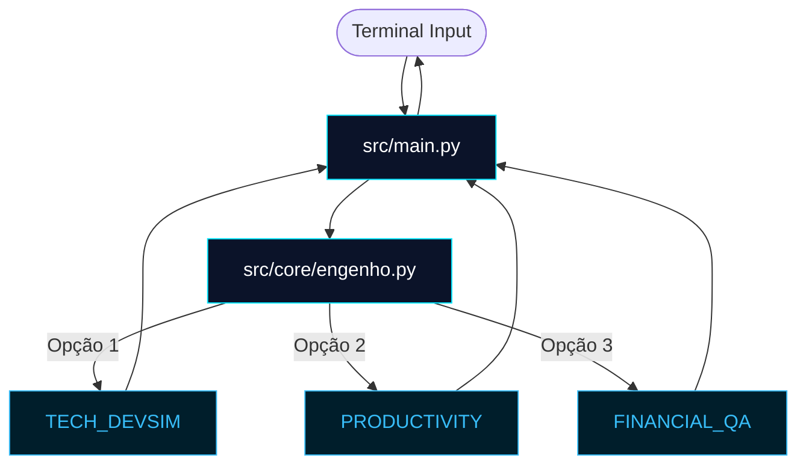
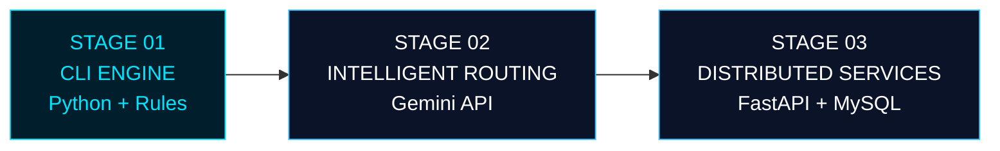

<div align="center">


<br/>

<h3>🧠 Modular AI Assistant | CLI Engine</h3>

<p>
  
  
  
  
  
</p>

</div>

---

## ⚡ Visão Geral do Sistema

A **Sexta-Feira (F.R.I.D.A.Y.)** é uma assistente modular desenvolvida em Python, projetada para centralizar funcionalidades de automação, organização e suporte ao desenvolvimento de software.

Sua arquitetura permite o isolamento de diferentes módulos funcionais, mantendo o desacoplamento entre responsabilidades e facilitando a evolução do projeto.

> 💡 **Conexão de Engenharia:** O projeto aplica conceitos de organização modular, validação, testes automatizados e integração contínua, inspirados nas práticas de qualidade utilizadas no ecossistema Java/Spring e adaptados ao desenvolvimento de soluções com Python e Inteligência Artificial.

---

## 🧭 Painel de Controle de Módulos

### F.R.I.D.A.Y. ENGINE — V1 CLI

Atualmente operando por uma interface de terminal, com utilização de Type Hints e organização modular.

| Módulo | Identificador | Responsabilidade |
|---|---|---|
| 💻 Tech | `TECH_DEVSIM` | Validação de código e simulação de entrevistas |
| 🏢 Productivity | `PRODUCTIVITY` | Organização de tarefas, atas e logs |
| 💰 Financial | `FINANCIAL_QA` | Controle financeiro e projeções básicas |

### 🔍 Detalhamento dos Módulos

#### 💻 Tech Development
Analisador lógico para trechos de código Python, com validações orientadas às diretrizes PEP 8 e simulador de questões técnicas envolvendo algoritmos e desenvolvimento de software.

#### 🏢 Productivity
Módulo destinado à organização de tarefas, relatórios operacionais, atas e registros de progresso, com geração de arquivos estruturados.

#### 💰 Financial Management
Motor de cálculos para controle financeiro pessoal, categorização de receitas e despesas e projeção básica de gastos.

---

## 🎨 Arquitetura e Fluxo de Execução

O diagrama abaixo representa o fluxo de execução da interface CLI e o direcionamento das solicitações para os módulos internos.



---

## ⚙️ Rigor Técnico & Qualidade

- **Type Hints:** utilização de anotações de tipos para melhorar a legibilidade, documentação e análise estática do código.
- **Testes Automatizados:** validação de comportamentos e regras por meio de Pytest.
- **Linting:** utilização do Ruff para análise estática e padronização do código.
- **Continuous Integration:** GitHub Actions executa verificações automatizadas e testes a cada push.
- **Modularidade:** separação entre interface, lógica central e módulos funcionais.

---

## 🏗️ Estrutura do Projeto

```text
sexta-feira/
├── .github/
│   └── workflows/
│       └── ci.yml
├── src/
│   ├── main.py
│   └── core/
│       └── engenho.py
└── tests/
    └── test_agente.py
```

---

## 🔮 Roadmap de Evolução



<div align="center">

### ⚡ F.R.I.D.A.Y. — Building the Future, One Module at a Time.

</div>

